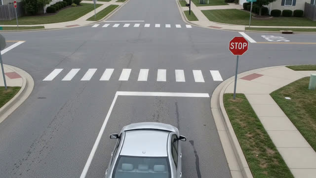
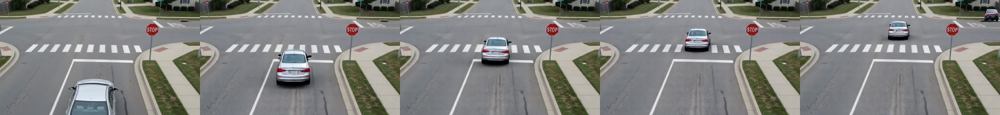
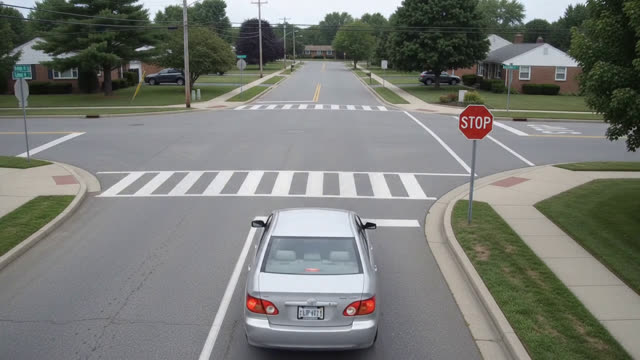
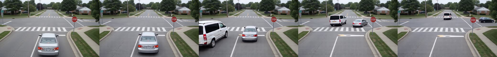
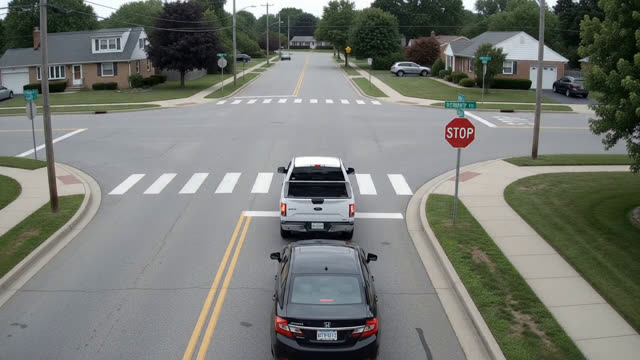
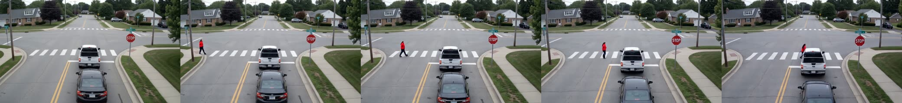

# Rare intersection events generated with Cosmos 3 Edge, run through the pipeline

Date: 2026-11-14. Board: `jetson-agx-thor` (MAXN). One session.

**This is offline test data generation, not live accident prediction.** Three short clips of events that cannot be filmed on purpose were drawn by an image-to-video model from a starting frame and a prompt, then scored by the existing detector, tracker and packs. The result says how the pipeline reacts to such clips. It does not measure real-world accuracy, and it is separate from the frozen generation protocol in `docs/generation/PLAN.md` (in the full build, not public), which uses other models and is still not run. The forecaster NO_GO is unchanged.

## What was run

| Item | Value |
|---|---|
| Generator | `nvidia/Cosmos3-Edge` (4B), revision `6afc1256321c3a8e623d89be3bc5117a1e90f96b`, BF16, image-to-video |
| Runtime | cosmos-framework at `1f1737931214166d5e7b253def319c562cf7a1eb`, Python 3.13.14, uv 0.11.29, torch 2.10.0 with CUDA 13.0, driver 580.00 |
| Command | `python -m cosmos_framework.scripts.inference -i <sample>.json -o <out> --checkpoint-path Cosmos3-Edge --seed=20261114 --no-use-torch-compile`, one clip per process, `HF_HUB_OFFLINE=1` |
| Sample settings | `model_mode` image2video, `resolution` "480", `aspect_ratio` "16,9", `num_frames` 121, seed 20261114. Output: 832x480, 24 frames a second, 5.04 s |
| Prompts | Short prompt and its upsampled form are both in [`plan.json`](plan.json). Upsampled with `cosmos_framework.inference.prompt_upsampling --mode image2video`, served by the Cosmos 3 Edge reasoner on the same board. The generator received the upsampled prompt ([`samples/`](samples/)) |
| Starting frames | Three stills from the existing stop-sign scene clips. Those clips are themselves synthetic (generated) footage, not camera recordings |
| Detector | Pinned RT-DETR R18 ONNX graph on its CPU contract, the detector the generation protocol freezes; every sixth frame (4 looks a second) |
| Rules | The production `PackRunner`: stop sign and moving object on one runner, two-gate speed on a second, driven on media time by `scripts/rare_event_clips.py` (in the full build, not public) |
| Zones and gates | Drawn by hand on each starting frame and written to `plan.json` before any clip was generated. The 8 m gate distance is an estimate from car length on screen, not a survey |
| Measured source | Working tree committed only in a separate evaluation checkout as `b7a34fd441bb6054f92adae407b94e74e13f4467` (parent `d4adce0`) |

The live service looks at a camera about once a second through a vision-language model. On a five-second clip that is two or three looks and no stop verdict, so the clips were scored offline with the same packs instead. No live-service result is claimed.

## The clips

Each strip shows frames 0, 30, 60, 90 and 120.

| Event asked for | Starting frame | Generated clip |
|---|---|---|
| A car rolls through the stop sign without stopping |  |  |
| A car runs the stop at speed while another car crosses |  |  |
| A pedestrian steps into the crosswalk from behind a parked car |  |  |

The clips are kept outside git on the workstation's backup disk; [`generation.json`](generation.json) holds their SHA-256.

## What the pipeline reported

From [`pipeline.json`](pipeline.json). Speed is the speed pack's number under the assumed 8 m gate distance, not a measured speed.

| Clip | Vehicles detected | Speed estimate | Stop-sign verdict | Pedestrian detected | Matches the prompt (checked by the owner, 2026-11-15) |
|---|---|---|---|---|---|
| `roll_through` | 2 tracks (the sedan and a parked car in the distance), a vehicle in 20 of 21 scored frames | 12.8 km/h | `no_stop` for the sedan (lowest speed in the zone 0.149 frame widths a second, 2.0 s in the zone) | none (0 of 21 frames) | **Partly.** The silver sedan rolls through the stop as asked. A second vehicle the prompt did not ask for appears in the adjacent intersection on the right, facing the wrong direction |
| `run_stop_cross_traffic` | 4 tracks (the sedan, a second moving vehicle, two parked cars), a vehicle in 21 of 21 | 19.2 km/h | `rolling_stop` for the sedan (lowest speed 0.075, just under the 0.08 line; 1.0 s in the zone) | none (0 of 21) | **No.** The second car overtakes the sedan on the same road, going straight. It does not cross from left to right, so the clip shows no cross traffic and no near miss |
| `pedestrian_from_behind_car` | 10 tracks for about 7 vehicles in view, a vehicle in 21 of 21 | none (no vehicle crossed both gates) | `rolling_stop` for the pickup at 2.5 s, then `compliant` for the pickup and the car behind it when the clip ended | yes: 1 pedestrian track in 19 of 21 frames, 5 moving-object reports | **Partly.** A person in a red jacket crosses in front of the white pickup, which is parked at the stop sign with another car behind it. The person does not come from behind the pickup, so the clip does not show someone hidden by a parked car |

What the detector, speed estimator and stop-sign check caught and missed, read against what each prompt asked for:

- **Caught.** The moving sedan was tracked in both stop-sign clips and got a violation verdict in each. The second moving vehicle in the cross-traffic clip was detected; the owner's check below found it overtakes the sedan and does not cross. The pedestrian was detected in 19 of 21 scored frames and reported as a walking pedestrian from 0.5 s.
- **Missed or wrong.** The car that the prompt asked to run the stop at speed was called `rolling_stop`, not `no_stop`: its lowest tracked speed fell just under the rolling line. In the roll-through clip the verdict was `no_stop` where the prompt asked for a roll. In the pedestrian clip the stationary pickup got a false `rolling_stop`: its track was lost and re-created mid-clip (10 tracks for about 7 vehicles), and a lost track with under a second in the zone is read as a roll.
- **Not covered by any pack.** Nothing in the pipeline relates the two vehicles in the cross-traffic clip or the pedestrian and the vehicles. There is no conflict, near-miss or yield rule, so those events produce no report of their own.

The owner watched the three clips on 2026-11-15 ([record](prompt_check_2026-11-15.json)). Two clips match their prompts in part and one does not show the event it was generated to test. None of the three matches in full. In `run_stop_cross_traffic` the pipeline's numbers were plausible (four vehicle tracks, a `rolling_stop` verdict) while the clip showed an overtake on the same road instead of cross traffic: the detector and packs cannot tell that a generated clip missed its event, so a person has to watch it. Before that check, this paragraph read the strips as follows, and the cross-traffic reading was wrong: The strips above show: the sedan driving through the stop line without an evident stop; the sedan passing the stop line while a white van crosses from the left, with the sedan ending up turned beside it; and a pedestrian in red walking from the left curb into the crosswalk while both vehicles stay still. In the third clip the pedestrian comes from the curb, not from behind a parked car.

## Time, memory and power per clip

From [`generation.json`](generation.json): board input power from tegrastats once a second, desktop session ended, no other model server loaded. Idle before the first clip: 17.2 W mean, 3.1 GB of board memory in use.

| Clip | Wall time, whole process | Sampler time from the log | Board power, mean | Board power, peak | Energy | Board memory in use, peak | Process peak resident memory |
|---|---|---|---|---|---|---|---|
| `pedestrian_from_behind_car` (first) | 125.3 s | 99 s | 75.5 W | 190.0 W | 2.60 Wh | 34.2 GB | 6.9 GB |
| `roll_through` | 117.0 s | 94 s | 82.0 W | 161.0 W | 2.64 Wh | 35.3 GB | 6.9 GB |
| `run_stop_cross_traffic` | 115.7 s | 93 s | 80.4 W | 164.9 W | 2.57 Wh | 35.8 GB | 6.9 GB |

Wall time includes starting the process and loading the model. The first clip started from 3.3 GB in use; the next two started near 30 GB because the board had not yet returned the previous run's memory after a 60 s rest, so their peaks are not increases of 35 GB. The detector took a median 0.52 s a scored frame on the board's CPU.

NVIDIA's published figure for Edge image-to-video on a Thor T5000 is 137.50 s at 480p through vLLM-Omni (153.00 s through PyTorch), and the model card states that figure for 189 frames. These clips are 121 frames through cosmos-framework with compilation turned off, so the numbers are not a like-for-like comparison.

## What was downloaded

All fetched before the first timed run; the timed runs were offline.

| Repository | Revision | Size on disk | Used by |
|---|---|---|---|
| `nvidia/Cosmos3-Edge` | `6afc1256321c3a8e623d89be3bc5117a1e90f96b` | 8.6 GB | generator and prompt upsampler |
| `nvidia/Cosmos-Guardrail1` | `d6d4bfa899a71454a700907664f3e88f503950cf` | 3.5 GB | text blocklist, face blur |
| `Qwen/Qwen3Guard-Gen-0.6B` | `fada3b2f655b89601929198343c94cd2f64d93cc` | 1.5 GB | text safety check |
| `Wan-AI/Wan2.2-TI2V-5B`, file `Wan2.2_VAE.pth` | `921dbaf3f1674a56f47e83fb80a34bac8a8f203e` | 2.7 GB | fetched by the first warm-up run; not named in the quickstart |
| `google/siglip-so400m-patch14-384` | `9fdffc58afc957d1a03a25b10dba0329ab15c2a3` | 3.3 GB | video safety classifier; downloaded but not loaded, the log says that stage is disabled in this release |

The framework environment is 9.3 GB. The guardrail failure seen on Cosmos Predict 2.5 (a guardrail model not cached) did not recur: with everything above cached, a run with `HF_HUB_OFFLINE=1` completes. The run log states that guardrail coverage in this release is text checks and face blur only.

## Friction points

| What broke | What fixed it | What NVIDIA could change |
|---|---|---|
| Generation failed during compilation: `ptxas-blackwell fatal: Value 'sm_110a' is not defined for option 'gpu-name'`. The bundled Triton assembler does not know the Thor GPU. | `--no-use-torch-compile`. | Ship an assembler that knows `sm_110a`, or turn compilation off automatically on this GPU and say so. |
| A sample file holding a JSON list fails with `TypeError: list indices must be integers or slices, not str` as soon as a command-line override such as `--seed` is given. | One JSON object per sample file. | Accept a list with overrides, or reject it with a message that names the expected shape. |
| Inference stops with `FileNotFoundError: 'uv'` when `uv` is not on the path: every run shells out to `uv run ... hf download` for each checkpoint, even when all of them are cached. | Put the pinned uv 0.11.29 on the path of the process. The board's own uv is 0.11.3 and the project refuses any version but 0.11.29, so the pinned one was installed beside it. | Resolve cached checkpoints in-process; do not require the installer at run time. |
| No way to pre-download only what one checkpoint needs. `prefetch_hf_checkpoints` fetches every model the project knows, and the first run fetched a VAE the quickstart does not name. | Downloaded the four repositories by hand, ran one small warm-up clip online, then confirmed an offline run. | A prefetch option for one checkpoint, and a list of what Edge image-to-video downloads. |
| The quickstart's `apt-get` line needs root, which this session did not have; `git-lfs` and `tree` were missing. | Nothing needed: clone, install and inference worked without them. | Mark which system packages inference needs. |
| The board had Python 3.12 only. | uv fetched a managed Python 3.13.14; the CUDA 13.0 group installed without changes (driver 580.00). | Nothing. |
| The prompt upsampler's documentation asks for "a vLLM-served Qwen3 model" without naming one. | Served the Cosmos 3 Edge reasoner already on the board and pointed the upsampler at it; all three prompts upsampled. | Name a tested model for the upsampler. |
| A live-service run of a five-second clip gives two or three looks and no verdict (this repository, not NVIDIA). | Scored offline on every sixth frame with the production packs. | Nothing. |

## Limits

- Generated clips test whether the pipeline reacts; they do not measure real-world accuracy.
- The model card says outputs are not physically accurate simulation. Motion and speed in a generated clip are not ground truth, so the speed and stop verdicts above cannot be scored as right or wrong, only compared with what the prompt asked for.
- Small sample: 3 events, 3 starting frames, one seed, one board, one session. No clip was regenerated or selected.
- BF16 only, the one precision the model card lists as tested.
- Stop zones, gates and the 8 m gate distance are hand-drawn assumptions on the starting frame.
- The starting frames come from synthetic clips, so these are generated continuations of generated scenes.
- The detector ran every sixth frame; the packs' thresholds were set for about one look a second, so box jitter weighs more here than in the live service.
- The "matches the prompt" check was done by one person, the owner, watching each clip once on 2026-11-15. None of the three matched in full.
- Night, rain and glare variants (Transfer) were not attempted. The Edge model card does not list Transfer.

## Reproduce the scoring

With the clips restored from the backup disk and the pinned detector graph, profile and receipt:

```bash
python -m scripts.rare_event_clips \
  --plan reports/generation/2026-11-14-cosmos3-edge-rare-events/plan.json \
  --clips-dir <clips> --model <model.onnx> --profile <profile.json> --receipt <receipt.json> \
  --output /tmp/pipeline.json
```
