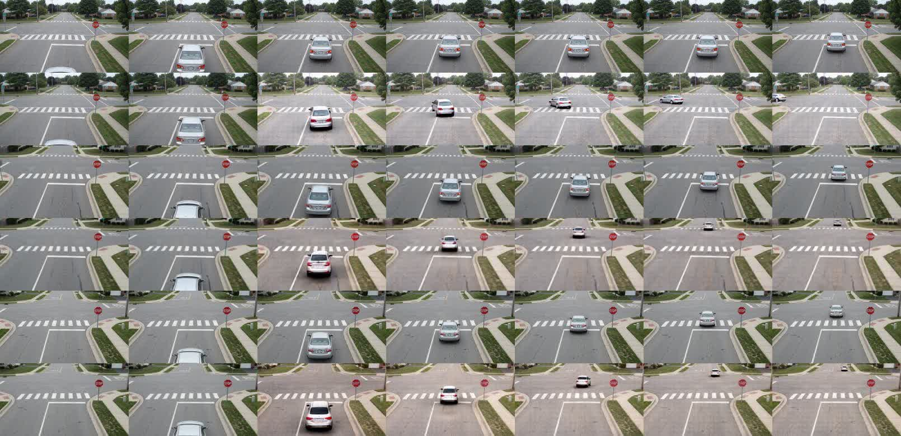
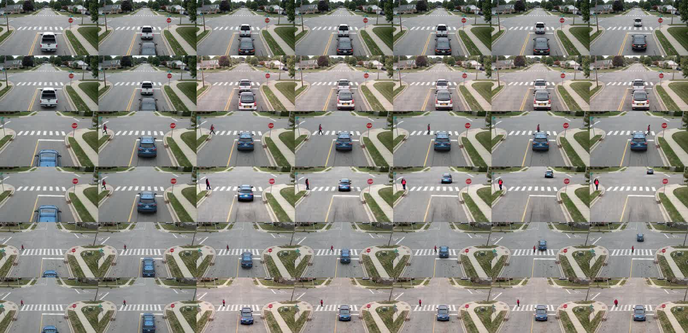

# Predicting the next four seconds at an intersection with Cosmos 3 Edge, 2026-11-15

**Generated footage on both sides. The source clips are themselves generated, and the predictions are generated from them. This measures no real-world accuracy.**

**Question.** Given only the first second of an approach to a stop sign, does the model's continuation show what then happened in the source clip?

The 2026-11-14 run told the model which event to draw. This run tells it nothing about the outcome. Each prompt is one neutral sentence naming what is in view at the start. The three single-car stop-sign clips (full stop, rolling stop, no stop) share one identical prompt, so any difference between their predictions comes only from the first second of video.

## Setup

| | |
|---|---|
| Board | `jetson-agx-thor` |
| Generator | `nvidia/Cosmos3-Edge` (4B), video-to-video, BF16, through NVIDIA cosmos-framework at `1f1737931214166d5e7b253def319c562cf7a1eb` |
| Window | 121 frames at 24 frames a second (5.04 s), starting 1.0 s into each source clip |
| Given to the model | The window's first 25 frames (1.04 s), as latent frames 0 to 6. The other 96 frames (4.0 s) are generated |
| Output | 832 x 480, seed 20261115, `--no-use-torch-compile`, one clip per process, offline |
| Measurement around the generator | `scripts/rare_event_generate.py` (in the full build, not public), unchanged ([`generation.json`](generation.json)) |
| Scoring | `scripts/rare_event_clips.py` (in the full build, not public), unchanged: pinned RT-DETR R18 and the production stop-sign, moving-object and speed packs, every sixth frame ([`pipeline.json`](pipeline.json)) |
| Zones and gates | Three reused from the 2026-11-14 plan, three drawn by hand on a frame of the window. All were written to [`plan.json`](plan.json) before any predicted clip was scored |
| Measured source | Evaluation checkout `b7a34fd441bb6054f92adae407b94e74e13f4467`, the same one that scored the 2026-11-14 clips |

## Result

Each source clip is scored twice with the same zone: the real five seconds and the predicted five seconds.

| Source clip | Stop-sign verdict, real | Stop-sign verdict, predicted | Same verdict | Speed pack, real | Speed pack, predicted |
|---|---|---|---|---|---|
| Full stop | `compliant` | `no_stop` | No | none | 23.0 km/h |
| Rolling stop | `rolling_stop`, `no_stop` | `no_stop` | In part | 10.5 km/h | 38.4 km/h |
| No stop | `no_stop` | `no_stop` | Yes | 16.5 km/h | 28.8 km/h |
| Queue, both stop | `no_stop`, `compliant` | `no_stop`, `compliant` | Yes | none | none |
| Yields to pedestrian | `compliant` | `no_stop` | No | none | 19.2 km/h |
| Fails to yield | `no_stop` | `compliant` | No | 12.8 km/h | none |

The stop-sign verdict matched in full on 2 of 6 clips and in part on 1. On both pedestrian clips the prediction gave the opposite verdict to what the source clip shows. Speed figures are the pack's number under the plan's assumed 8 m gate distance, not measured speeds.

Each pair shows the real clip above its prediction, at frames 0, 20, 40, 60, 80, 100 and 120. Top to bottom: full stop, rolling stop, no stop.

Top to bottom: queue, yields to pedestrian, fails to yield.

## What the strips show

Read from the strips above by the author of the run. **Not yet checked by the owner watching the clips.** The 2026-11-14 report shows why that matters: a strip reading there was wrong.

| Source clip | Real | Predicted |
|---|---|---|
| Full stop | The sedan stops at the line and stays | The sedan does not stop and turns left across the intersection |
| Rolling stop | The sedan slows and goes straight on | The sedan goes straight on, faster |
| No stop | The sedan goes straight through | The sedan goes straight through, faster |
| Queue, both stop | The pickup stops at the line with a dark car behind, and has started to leave by the end | Both vehicles stop and stay; the second vehicle changes into a white car |
| Yields to pedestrian | The car stops and the pedestrian crosses | The car drives through and the pedestrian stays at the curb |
| Fails to yield | The car drives through while the pedestrian is in the crosswalk | The car stops at the line and stays; the pedestrian stays at the side |

**What this says.** One second of an approach does not fix what happens next, and the model does not act as if it did. It continues the motion into one plausible future. With a single car and nothing else in view, that future was "keeps driving" three times out of three, which is right for the two clips where the car did not stop and wrong for the full stop. With a second road user in view, it picked the other outcome both times. The continuations are usable as varied test footage that starts from a real opening. They are not a forecast of the source clip.

Two visible changes after the given frames: the picture gets lighter, and vehicles move faster than in the source (the speed pack reads 19 to 38 km/h on predictions against 10 to 17 km/h on the real clips).

## Cost on the board

One process per clip, model load included ([`generation.json`](generation.json)):

| Measure | Lowest to highest of 6 clips |
|---|---|
| Time, start to exit | 122 to 127 s |
| Time in the sampler alone | 94 to 97 s |
| Board input power, mean | 79.6 to 88.8 W |
| Energy per clip | 2.79 to 3.01 Wh |
| Peak board memory in use | 33.3 to 34.9 GB |

Idle before the batch: 17.0 W mean over 59 s.

## Friction points

| What happened | What was done | What NVIDIA could change |
|---|---|---|
| NVIDIA's generation guide lists video-to-video cases for Cosmos3-Nano and Cosmos3-Super and none for Cosmos3-Edge. | Tried Edge with `model_mode` `video2video`; it ran and continued the clip. | List Edge in the video-to-video table, or say it is untested. |
| How many frames the model keeps from the input video is set by `condition_frame_indexes_vision`, in latent frames. The default for video is `[0, 1]`, which is 5 pixel frames. The guide does not say this. | Read it in the framework's argument definitions and set `[0, 1, 2, 3, 4, 5, 6]` for 25 frames. | Document the setting and the latent-to-pixel frame count beside the video-to-video example. |
| The generator's command failed with `FileNotFoundError: 'uv'` when started from a shell without the pinned `uv` on the path. | Put the pinned `uv` directory on `PATH` for the run. | Fail with a message that names the missing tool, or call it by absolute path. |

## Limits

- Six source clips, one seed, one continuation each. A different seed can give a different future; this run does not measure how often.
- The source clips are generated footage with the outcome in their file names. No camera recording is involved.
- The prompts are neutral but not empty. "Drives toward the stop line" may still lean the model toward motion.
- The "queue, both stop" source clip gets `no_stop` and `compliant` from the pack on the real footage, so its label and the pack's reading of it differ before any prediction.
- No pack relates a vehicle to a pedestrian. The pedestrian clips are compared on the stop-sign verdict only.
- Clips are kept outside git on the workstation's backup disk; `generation.json` and [`windows.json`](windows.json) hold their SHA-256.
