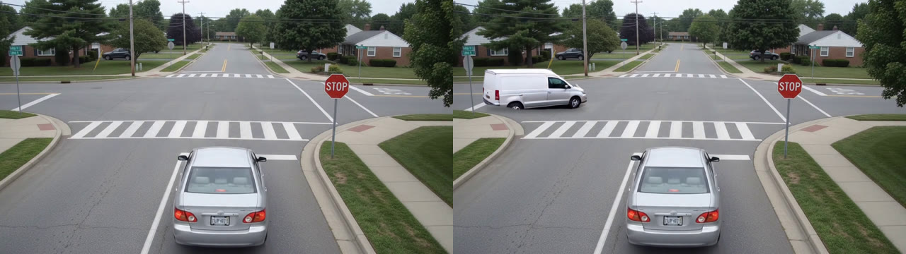
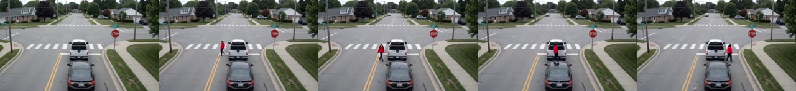
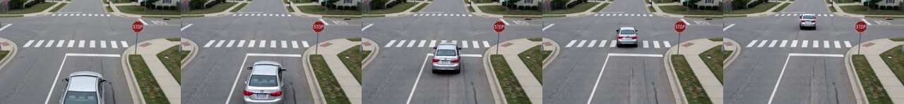
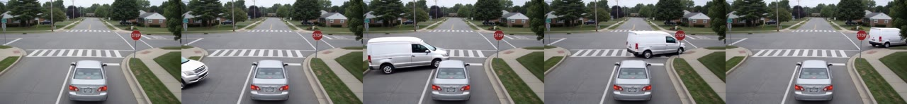
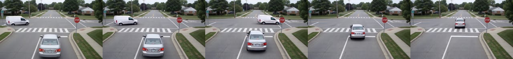

# Writing rare-event prompts that the generator follows, 2026-11-15

**Generated footage, offline test data. No real-world accuracy is measured.**

On 2026-11-14 Cosmos 3 Edge drew three rare intersection events, and the owner's check found that none of the three matched its prompt in full ([report](../2026-11-14-cosmos3-edge-rare-events/README.md), [check](../2026-11-14-cosmos3-edge-rare-events/prompt_check_2026-11-15.json)). This run asks what it takes to get them right. Everything except the prompt was held fixed: the same starting frames, the same seed (20261114), the same model, revision, resolution and flags on `jetson-agx-thor`, and the same zones and gates for scoring.

## What went wrong in round one

The round-one short prompts were reasonably specific. They were not what the generator received. The framework's prompt upsampler expanded each one into a structured caption, and the expansion contradicted the short prompt ([round-one samples](../2026-11-14-cosmos3-edge-rare-events/samples/)):

| Event | The short prompt asked for | The expanded prompt the generator received said |
|---|---|---|
| Roll through | "slows only slightly, rolls through the stop sign without ever stopping" | "The sedan stops precisely at the STOP line and crosswalk" |
| Cross traffic | "a second car crosses the intersection from left to right on the cross street directly ahead of it" | the sedan "brakes initially" and "stops briefly"; the van crosses "in the opposite intersection"; an invented black SUV "remains parked" |
| Pedestrian | "steps out from behind the parked pickup truck" | "starts walking across the crosswalk from left to right"; the "from behind" was dropped |

## Round two: the full prompt written by hand

The structured caption was written by hand in the same format and sent to the generator as written, with no upsampler ([samples](samples/)). Three rules:

1. **Compass directions, not left and right.** The background states that the camera looks north, so the left of the picture is west and the right is east. Every motion is given as north, east or west.
2. **Say what must not happen.** For example: "No other vehicles enter the scene", "No vehicle overtakes the sedan", "The pedestrian does not start on a sidewalk or curb".
3. **Second-by-second timing.** Each action has a time range, for example "0:01-0:03: the van drives east through the middle of the intersection, directly in front of the sedan".

## Round three: a reference frame for the second vehicle

The cross-traffic event needs two vehicles in the right places at once, and the starting frame showed only one. In round two the model invented where the van came from. Round three used two stages:

1. **Reference frame.** The van was cut from a frame of the round-two clip, using its outline and the difference against an earlier frame of the same clip, scaled to 300 pixels long, and placed with a soft shadow on the cross street on the west side, in the eastbound lane, facing east. Original and edited frames:

2. **Clip.** The prompt then described only the motion: both vehicles moving from the first frame, the sedan crossing the stop line at 0:01, the van staying on the cross street, beyond the near crosswalk, and keeping its size.

The edited frame is a constructed input, not a frame of any source clip. Its SHA-256 is `ba37d1ddc8046ce88bb8f5b1ff9437ca401d30674c3cbac8eb8fcbf6d1a353bc`; the original frame is `b6ce5241eeb096f9e3808f2c5627da4a4777d48aeb2eb6e2c442b188dff34627`.

## Result

Checked by the owner watching each clip ([record](prompt_check_2026-11-15.json)).

| Event | Round one (upsampled prompt) | Round two (hand-written prompt) | Round three (reference frame and prompt) |
|---|---|---|---|
| Pedestrian steps out from behind the pickup | Partly | **Yes** | |
| Car rolls through the stop | Partly | **Yes** | |
| Car runs the stop with cross traffic | No | No | **Yes** |

Specific wording alone fixed both single-actor events. The two-actor event also needed the second vehicle placed in the starting frame. The owner's note on round three: the van's starting heading is slightly angled, so at first it looks as if it may turn left before it goes straight across. That angle came from the van that was placed.

Each strip shows frames 0, 30, 60, 90 and 120.

| Clip | Frames |
|---|---|
| Pedestrian, round two |  |
| Roll through, round two |  |
| Cross traffic, round two |  |
| Cross traffic, round three |  |

## What the pipeline reported

Scored with `scripts/rare_event_clips.py` (in the full build, not public), unchanged, on the 2026-11-14 zones and gates ([round two](pipeline_round2.json), [round three](pipeline_round3.json)). Speeds are the pack's number under the assumed 8 m gate distance.

| Clip | Vehicle tracks | Stop-sign verdicts | Speed pack | Pedestrian |
|---|---|---|---|---|
| Pedestrian, round two | 7 | `compliant` for the car and for the pickup | none | 1 track, in 18 of 21 scored frames |
| Roll through, round two | 1 | `no_stop` | 19.2 km/h | none |
| Cross traffic, round two | 6 | `rolling_stop` for the stationary sedan, `no_stop` for the van passing through the zone | none | none |
| Cross traffic, round three | 5 | `rolling_stop` for the sedan (lowest speed in the zone 0.072 frame widths a second, just under the 0.08 line) | 14.4 km/h | none |

In round three the prompt asked for the sedan to run the stop without braking, and the stop-sign pack read it as a rolling stop. The owner's check covered whether the event happened as a scene; the pack's reading shows the generated sedan slowed more than the prompt asked.

## Cost on the board

One process per clip, model load included ([round two](generation_round2.json), [round three](generation_round3.json)):

| Clip | Time | In the sampler | Mean board power | Energy | Peak board memory |
|---|---|---|---|---|---|
| Pedestrian, round two | 123.5 s | 99 s | 82.9 W | 2.83 Wh | 33.3 GB |
| Roll through, round two | 116.1 s | 93 s | 81.4 W | 2.60 Wh | 34.6 GB |
| Cross traffic, round two | 114.2 s | 92 s | 85.7 W | 2.69 Wh | 35.0 GB |
| Cross traffic, round three | 119.8 s | 97 s | 81.7 W | 2.70 Wh | 35.0 GB |

## Lessons

- **Read the prompt the generator actually receives.** An automatic upsampler can contradict the prompt it was given. It reversed "never stops" into "stops precisely".
- **Use directions fixed to the scene.** "West side of the intersection" names one place; "left to right" depends on who is looking.
- **Name what must not happen.** The unrequested wrong-way car in round one disappeared once the prompt said no other vehicle enters.
- **Anchor every actor in the starting frame.** The model handled actors it could see from the first frame. A second vehicle that only existed in words was placed wherever the model chose.
- **A person still has to watch.** In round one the pipeline's numbers looked plausible on a clip that did not show its event.

## Limits

- Three events, one seed, one clip each per round. How often each prompt succeeds over many seeds is not measured.
- The rounds were judged by one person, the owner, watching each clip once.
- The round-three starting frame was edited by hand, and the van in it was taken from a generated clip.
- All footage is generated. The starting frames come from the existing stop-sign scene clips, which are generated footage themselves.
- Clips are kept outside git on the workstation's backup disk; the generation records hold their SHA-256.
